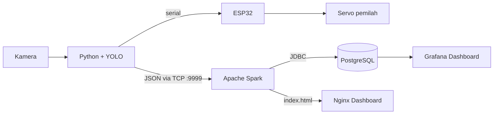

# Smart Fruit Quality Sorter

Sistem penyortir jeruk otomatis berbasis **AIoT**: kamera dan model **YOLO** menilai kualitas jeruk ("bagus" atau "jelek"), **ESP32** menggerakkan servo pemilah, dan log deteksi mengalir secara real-time melalui **Apache Spark** di klaster **Kubernetes (K3s)** ke **PostgreSQL**, lalu ditampilkan di dashboard **Grafana**. Jaringan pendukungnya dirancang dengan VLAN, Inter-VLAN routing, DHCP, dan ACL.

Dikerjakan sebagai projek akhir mata kuliah Big Data, Teknologi Server, dan Perancangan Jaringan (D-IV Teknologi Rekayasa Internet, Sekolah Vokasi UGM, 2026).

> [Tambahkan GIF atau foto prototipe di sini: `docs/images/demo.gif`]

## Fitur

- Klasifikasi kualitas jeruk real-time dengan YOLO (mode classify, ultralytics dan OpenCV), threshold keyakinan 80%
- Aktuator fisik: ESP32 dan servo memilah jeruk lewat perintah serial dari Python
- Pipeline data end-to-end: JSON lewat TCP socket, Spark, PostgreSQL, Grafana
- Deployment berbasis container di K3s (Spark, PostgreSQL, Grafana, Nginx)
- Dashboard HTML real-time yang disajikan lewat Nginx
- Jaringan tersegmentasi (VLAN IoT, Server, Admin, Security) dengan ACL

## Arsitektur



Tiga lapisan: **Edge** (kamera, YOLO, ESP32), **Data** (Spark, PostgreSQL), dan **Visualisasi** (Grafana, Nginx). Spark juga memisahkan beban kerja: skrip di laptop cukup mengirim satu baris JSON, tanpa mengetahui lokasi atau kredensial database.

## Teknologi

| Lapisan | Teknologi |
|---|---|
| Computer vision | YOLO (ultralytics), OpenCV, Python |
| IoT | ESP32, servo, komunikasi serial (pyserial) |
| Data | Apache Spark 3.5.0 (PySpark), PostgreSQL 15 |
| Visualisasi | Grafana OSS 10.4.1, Nginx |
| Infrastruktur | Ubuntu Server 24.04, Kubernetes (K3s/MicroK8s), VirtualBox |
| Jaringan | Cisco Packet Tracer: VLAN, Inter-VLAN routing, DHCP, ACL |

## Perangkat keras

ESP32 dengan dua servo (pendorong di GPIO 25, gerbang di GPIO 26), kamera yang terhubung ke laptop, dan laptop yang menjalankan model. Firmware, tabel pin, dan cara upload ada di `firmware/`.

## Model dan logika penyortiran

Model dilatih sebagai klasifikasi citra dua kelas (`good` dan `bad`) dengan YOLOv8n-cls, memakai sekitar 2.000 gambar: 1.000 untuk training dan 1.000 untuk validasi, 100 epoch dengan augmentasi (lihat `training/`).

| Kondisi | Aksi |
|---|---|
| `good` dengan keyakinan 80% atau lebih, konstan selama 3 detik | kirim `G` ke ESP32, lalu catat log |
| `bad` dengan keyakinan 80% atau lebih | langsung kirim `B` (reject), lalu catat log |
| tidak ada objek atau keyakinan di bawah 80% | kirim `N` (standby) |

Jeda 3 detik pada kelas `good` mencegah pemilahan salah akibat klasifikasi yang sesaat.

## Struktur repositori

```
firmware/  kode ESP32 (servo pemilah)
edge/      skrip sisi laptop (klasifikasi YOLO, kontrol ESP32, kirim log)
training/  skrip dan catatan pelatihan model
spark/     penerima log dan penulisan ke PostgreSQL, dashboard HTML
k8s/       manifest Kubernetes (Spark, PostgreSQL+Grafana, Nginx)
sql/       skema tabel
scripts/   sinkronisasi dashboard ke Nginx
network/   desain jaringan (VLAN, DHCP, ACL)
docs/      laporan dan gambar
models/    bobot model YOLO (tidak di-commit)
```

## Cara menjalankan

**1. Siapkan klaster K3s** dan pastikan node aktif:
```bash
kubectl get nodes
```

**2. Deploy Spark Master:**
```bash
kubectl create namespace spark
kubectl apply -f k8s/spark-core.yaml -n spark
```

**3. Deploy PostgreSQL dan Grafana.** Buat Secret dari contoh (jangan commit file aslinya):
```bash
cp k8s/postgres-secret.example.yaml k8s/postgres-secret.yaml   # isi user dan password
kubectl apply -f k8s/postgres-secret.yaml
kubectl apply -f k8s/app.yaml
```

**4. Buat tabel:**
```bash
kubectl exec -i deploy/postgres-grafana -c postgres -- psql -U <user> -d grafana_db < sql/init.sql
```

**5. Jalankan penerima log di node Ubuntu** (butuh Java dan `pip install -r requirements.txt`):
```bash
cp .env.example .env   # isi nilainya, lalu: set -a; source .env; set +a
python spark/spark_processor.py
```

**6. (Opsional) Latih ulang model:** siapkan dataset di `datasets/` lalu jalankan `python training/train.py`. Salin hasilnya ke `models/best.pt`.

**7. Jalankan skrip edge di laptop** yang terhubung ke kamera dan ESP32:
```bash
python edge/sorter_edge.py
```
Isi `SPARK_HOST` di `.env`: setiap keputusan good/bad dikirim sebagai log JSON ke Spark (port 9999), sesuai alur di laporan. Upload dulu firmware di `firmware/sorter_esp32/` ke ESP32.

**8. Buka Grafana** di `http://<IP-Node>:30300`, tambahkan data source PostgreSQL (`<IP-Node>:30432`, database `grafana_db`), lalu buat panel dengan query, misalnya:
```sql
SELECT kategori, SUM(jumlah) AS total FROM sortir_jeruk GROUP BY kategori;
```

**Opsional, dashboard Nginx:** `kubectl apply -f k8s/nginx-deployment.yaml`, lalu jalankan `scripts/sync_dashboard.sh`. Dashboard tersedia di `http://<IP-Node>:30081`.

| Layanan | NodePort |
|---|---|
| Spark Master | 30077 |
| Spark Web UI | 30080 |
| PostgreSQL | 30432 |
| Grafana | 30300 |
| Nginx dashboard | 30081 |

## Hasil

- Seluruh layanan (Spark Master, PostgreSQL, Grafana) berjalan stabil di klaster K3s.
- YOLO mengklasifikasikan jeruk secara real-time, dan hasilnya langsung menggerakkan servo pemilah serta tercatat di database.
- Pada sesi uji, dashboard Grafana menampilkan panel "Total Jeruk Bagus" dan "Total Jeruk Jelek" yang diperbarui otomatis setiap ada data baru.
- Jaringan: DHCP memberi IP sesuai VLAN, komunikasi antar VLAN berjalan lewat multilayer switch, dan ACL memblokir Security PC dari server (lihat `network/`).

> [Tambahkan akurasi validasi model (top-1 accuracy), confusion matrix dari `runs/classify/train/`, dan screenshot dashboard di sini]

## Dokumentasi

Laporan lengkap ada di `docs/laporan/`: Big Data, Teknologi Server, dan Perancangan Jaringan.

## Peran dan tim

Peran saya: **Programmer dan Project Manager**. Anggota tim: [isi nama, setelah mendapat izin].

## Catatan keamanan

Kredensial tidak disimpan di repositori. Gunakan `.env` (di-`.gitignore`) dan Kubernetes Secret. Ganti semua password contoh sebelum menjalankan sistem.

## Lisensi

[Pilih lisensi, mis. MIT, lalu tambahkan file LICENSE]
